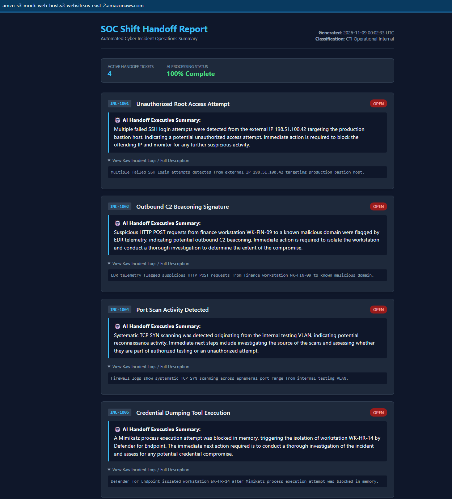

# Serverless SOC Shift Handoff Automation (AWS S3 + Lambda + OpenAI)

> 🔗 **Live Demo Endpoint:** [View Live SOC Shift Handoff Report](http://amzn-s3-mock-web-host.s3-website.us-east-2.amazonaws.com/)

An event-driven AWS serverless security automation pipeline designed to streamline SecOps shift handoffs. When incident ticket CSV exports are uploaded to an ingestion bucket, AWS Lambda parses active alerts, queries OpenAI via AWS Secrets Manager for executive threat summaries, and generates a responsive, dark-mode SOC shift handoff report hosted on Amazon S3.

---

## 📌 Key Features

**Event-Driven Cloud Architecture:** Private S3 ingestion bucket triggers AWS Lambda automatically on any `.csv` upload (`s3:ObjectCreated:*`).
**Enterprise Credential Governance:** Fetches OpenAI API credentials dynamically at runtime using **AWS Secrets Manager** (`ShiftAutomation/OpenAIKey`), keeping execution code stateless and secure.
**Automated Threat Summarization:** Uses `pandas` to isolate active `OPEN` alerts and queries OpenAI (`gpt-4o-mini`) to generate 2-sentence executive handoff summaries.
**Dynamic Web Artifact Publishing:** Compiles processed threat data into a dark-mode HTML template and streams `index.html` directly to a public S3 static web hosting bucket.

---

## 🏗️ Architecture Overview

**Ingestion Layer:** User or SIEM export drops `.csv` ticket file into `amzn-s3-mock-cyber-tickets` S3 bucket.
**Compute Layer:** S3 event notification invokes `process-shift-handoff` AWS Lambda function (Python 3.11, x86_64).
**Secrets Layer:** Lambda retrieves API credentials securely from AWS Secrets Manager using `boto3`.
**Data & AI Processing:** Lambda parses CSV data, filters active security incidents, and retrieves AI threat summaries.
**Presentation Layer:** Processed data is compiled into a dark-mode template and published to `amzn-s3-mock-web-host` S3 static web host.

---

## 📂 Repository Structure

aws-shift-automation/

├── src/

│ └── lambda_function.py # Primary Lambda handler script

├── templates/

│ └── shift_report_template.html # Dark-mode SOC handoff HTML/CSS template

├── samples/

│ └── cybersecurity_tickets_mock.csv# Sample ticket dataset for testing

├── .gitignore # Git exclusion rules

├── requirements.txt # Python dependencies

└── README.md # Project documentation 